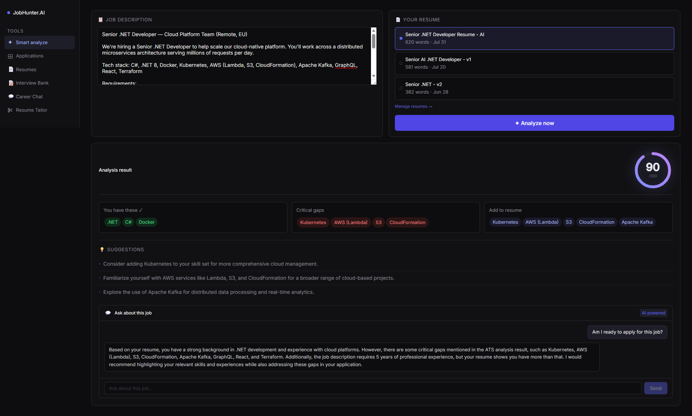
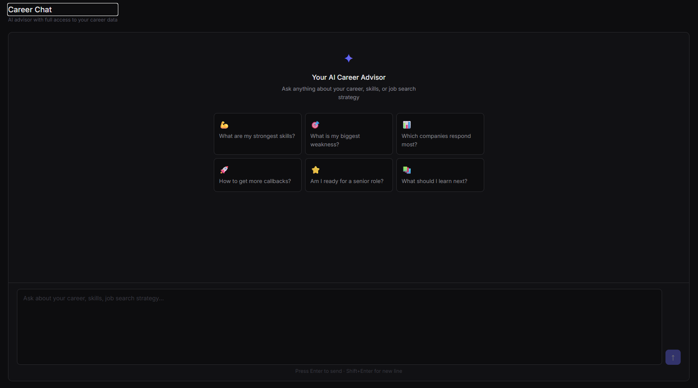
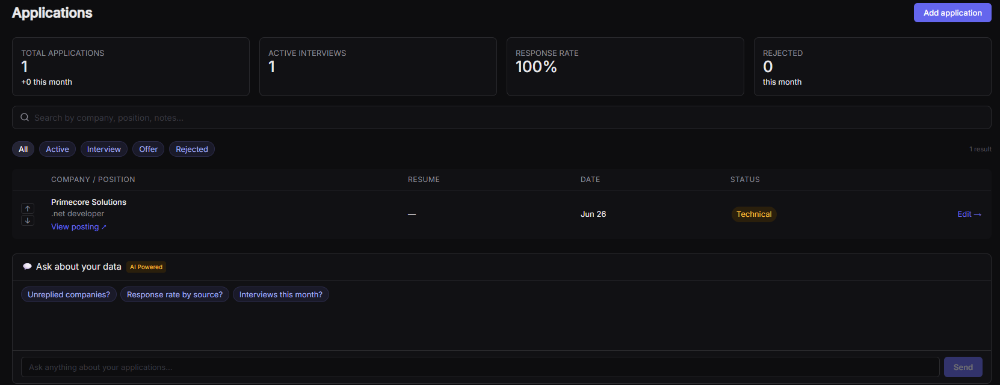
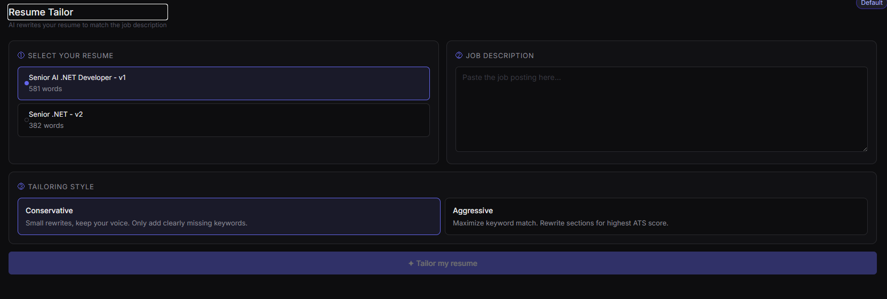

# 🎯 JobHunter.AI

**A hybrid, local-first AI career assistant — resume analysis, interview prep, and application tracking with zero hallucinations.**


[](https://dotnet.microsoft.com/)
[](https://dotnet.microsoft.com/apps/aspnet/web-apps/blazor)
[](https://www.postgresql.org/)
[](https://ollama.com/)
[](https://www.docker.com/)
[](./LICENSE)
[](https://deepwiki.com/hadihamedian/JobHunter.AI)

---

## 🧭 Overview

JobHunter.AI is an end-to-end career management platform built to solve a very practical problem: **generic AI resume tools hallucinate, and generic ATS tools are dumb**. This project takes a hybrid approach — deterministic, rule-based logic where accuracy matters (skill matching, scoring) combined with a **local LLM (via Ollama)** for the parts that genuinely benefit from generative reasoning (chat, tailoring, interview question generation).

Everything runs **locally by default** — no data ever has to leave your machine, no API keys, no per-token cost. It's both a daily-use tool for managing a job search and a demonstration of applied .NET + AI architecture: Minimal APIs, Blazor WebAssembly, PostgreSQL, and a pragmatic RAG/prompting layer on top of Ollama.

> Originally shipped as **JobAssistant**, renamed and re-architected as **JobHunter.AI**.

---

📸 Screenshots
| Smart Analyze | Career Chat |
| :---: | :---: |
|  |  |

| Applications Dashboard | Resume Tailor |
| :---: | :---: |
|  |  |

---

## ✨ Key Features

| Module | What it does |
|---|---|
| 🧠 **Smart Analyze** | Deterministic resume-to-job-description matching — real skill-gap detection, not vague AI guessing |
| 💬 **Career Chat** | Conversational assistant for career advice, grounded in your own resume/profile data |
| 📊 **Applications Dashboard** | Track every application: status, dates, notes, outcomes, source, with delete/filter/AI-powered semantic search |
| 📄 **Resume Manager** | Store, organize, and version multiple resumes |
| 🎯 **Resume Tailor** | Generates a job-specific tailored resume, exported as a clean Markdown → PDF |
| 🗣️ **Interview Prep** | AI-generated, role-specific interview questions and talking points |
| 🏦 **Interview Bank** | A growing, searchable bank of past interview questions and answers |

---

## 🏗️ Architecture

JobHunter.AI is a two-project solution: a Minimal API backend and a Blazor WebAssembly frontend, backed by PostgreSQL for persistence and Ollama for local inference. The whole stack ships as three containers behind an Nginx reverse proxy.

```
┌──────────────────────────────────────────────────────────────┐
│                        Nginx (reverse proxy)                  │
│                     serves Blazor WASM + /api/* → api         │
└───────────────────────────────┬────────────────────────────────┘
                                 │
                ┌────────────────┴─────────────────┐
                │                                   │
┌───────────────▼───────────┐        ┌──────────────▼───────────────┐
│   JobHunter.AI.Web          │  HTTP  │      JobHunter.AI.Api          │
│   (Blazor WebAssembly)      │◄──────►│      (ASP.NET Core Minimal)   │
│                             │        │                                │
│  Pages:                     │        │  Services:                    │
│   • Applications             │        │   • AiAnalyzerService          │
│   • CareerChat                │        │   • CareerAdvisorService       │
│   • Resumes                   │        │   • CareerChatService          │
│   • ResumeTailor                │        │   • DataChatService             │
│   • InterviewBank                │        │   • SemanticSearchService        │
└─────────────────────────────┘        │   • InterviewGeneratorService     │
                                        │   • ResumeTailorService            │
                                        │   • ResumeRecommendationService     │
                                        │   • Repositories (Postgres)          │
                                        └───────────────┬───────────────────────┘
                                                        │
                                            ┌───────────▼────────────┐
                                            │   Ollama (local LLM)     │
                                            │   qwen2.5-coder:7b       │
                                            │   (runs on the host)     │
                                            └─────────────────────────┘
                                                        │
                                            ┌───────────▼────────────┐
                                            │      PostgreSQL          │
                                            │      (Docker container)  │
                                            └─────────────────────────┘
```

**Design principle:** deterministic logic (skill matching, scoring, structured data, ID validation on AI output) stays in plain C# services — the LLM is only invoked where natural-language generation or reasoning is genuinely required (chat, tailoring, question generation, semantic search intent). This keeps results explainable and reproducible instead of a black box.

> **Note on Ollama:** Ollama is intentionally **not** containerized — it runs on the host machine (to use your GPU/CPU directly without Docker overhead) and is reached from the containers via `host.docker.internal`.

---

## 🛠️ Tech Stack

- **Backend:** ASP.NET Core Minimal API (.NET 10)
- **Frontend:** Blazor WebAssembly
- **Database:** PostgreSQL (via Npgsql)
- **AI/LLM:** [Ollama](https://ollama.com/) running `qwen2.5-coder:7b` locally
- **Reverse Proxy:** Nginx (serves the WASM app, proxies `/api/*` to the backend)
- **Containerization:** Docker & Docker Compose
- **Export:** Markdown-based PDF generation for tailored resumes

---

## 🚀 Getting Started

### Option A — Docker (recommended)

This is the fastest way to get the full stack (API + Web + PostgreSQL) running, with Nginx handling routing between the two.

#### Prerequisites

- [Docker](https://docs.docker.com/get-docker/) & Docker Compose
- [Ollama](https://ollama.com/download) installed **on the host** (not containerized), with the model pulled:
  ```bash
  ollama pull qwen2.5-coder:7b
  ```

#### Run it

```bash
# Clone the repo
git clone https://github.com/hadihamedian/JobHunter.AI.git
cd JobHunter.AI

# Build and start everything (API, Web, Postgres) in the background
docker compose up --build -d
```

The app will be available at **http://localhost** (Nginx serves the Blazor app and proxies `/api/*` to the backend container). Postgres data persists in a named Docker volume across restarts.

#### Common commands

```bash
# Rebuild after changing code, without touching Postgres
docker compose up --build -d

# Rebuild only specific services (faster)
docker compose up --build -d api web

# View logs
docker compose logs -f api

# Force a clean rebuild (bypass Docker's build cache)
docker compose build --no-cache
docker compose up -d

# Stop and remove containers (keeps the Postgres volume/data)
docker compose down

# Stop and wipe everything, including the database volume
docker compose down -v
```

> **Linux users:** if Ollama refuses connections from inside the container, confirm `docker-compose.yml` has `extra_hosts: ["host.docker.internal:host-gateway"]` on the `api` service — this is already configured, but worth knowing if you customize the compose file.

---

### Option B — Manual (without Docker)

#### Prerequisites

- [.NET 10 SDK](https://dotnet.microsoft.com/download)
- [PostgreSQL](https://www.postgresql.org/download/) (running locally or accessible via connection string)
- [Ollama](https://ollama.com/download) installed, with the model pulled:
  ```bash
  ollama pull qwen2.5-coder:7b
  ```

#### Configuration

Update `JobHunter.AI.Api/appsettings.json` with your local settings:

```json
{
  "Ollama": {
    "Url": "http://localhost:11434/api/generate",
    "Model": "qwen2.5-coder:7b"
  },
  "ConnectionStrings": {
    "DefaultConnection": "Host=localhost;Database=jobhunter;Username=postgres;Password=postgres"
  }
}
```

#### Run it

```bash
# Start the API
cd JobHunter.AI.Api
dotnet run

# In a separate terminal, start the Blazor client
cd JobHunter.AI.Web
dotnet run
```

The API will be available at the port shown in the console (see `Properties/launchSettings.json`), and the Blazor app will proxy requests to it.

---

## 📂 Project Structure

```
JobHunter.AI/
├── JobHunter.AI.Api/            # Backend - Minimal API
│   ├── Models/                  # Request/response DTOs
│   ├── Services/                # Business logic + Ollama integration
│   ├── Dockerfile
│   └── Program.cs
│
├── JobHunter.AI.Web/            # Frontend - Blazor WASM
│   ├── Pages/                   # Applications, CareerChat, Resumes, ResumeTailor, InterviewBank
│   ├── Layout/
│   ├── Models/
│   ├── Services/                # HTTP clients to the API
│   ├── wwwroot/
│   │   └── nginx.conf           # Serves WASM + proxies /api/* to the api container
│   ├── Dockerfile
│   └── Program.cs
│
├── docker-compose.yml           # API + Web + PostgreSQL, one command to run all three
└── JobHunter.AI.slnx
```

---

## 🗺️ Roadmap

- [ ] Authentication / multi-user support
- [ ] Configurable LLM backend (swap Ollama models or providers)
- [ ] Richer analytics on the Applications Dashboard
- [x] Dockerized setup (API + Web + Postgres in one `docker compose up`)

---

## 📜 License

Licensed under the [MIT License](./LICENSE).

---

## 👤 Author

**Hadi Hamedian** — Senior .NET Developer & Technical Lead
Building AI-integrated .NET systems, remote-first.

[GitHub](https://github.com/hadihamedian) · Open to remote contract work (GMT+3:30)
