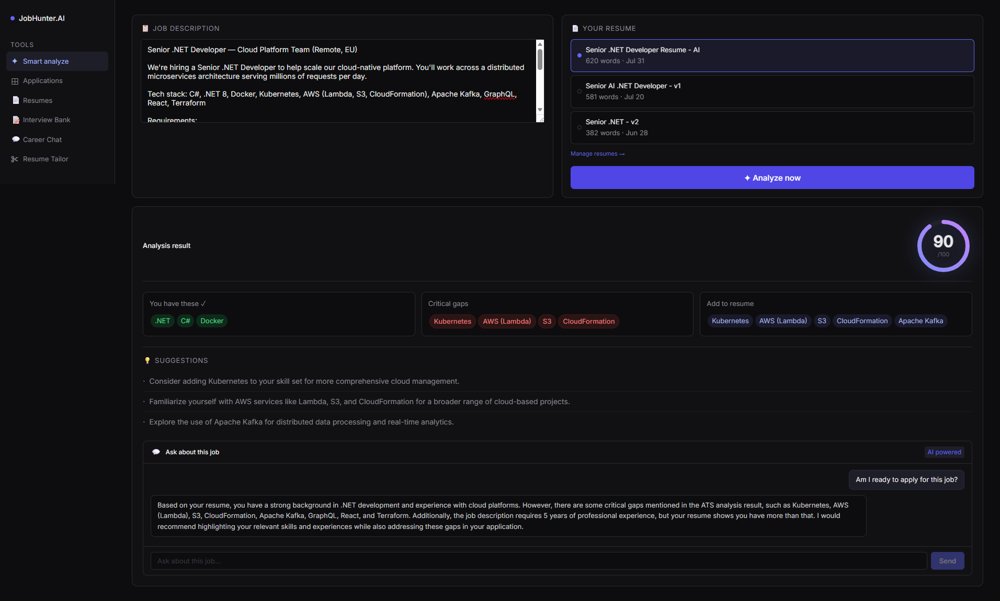
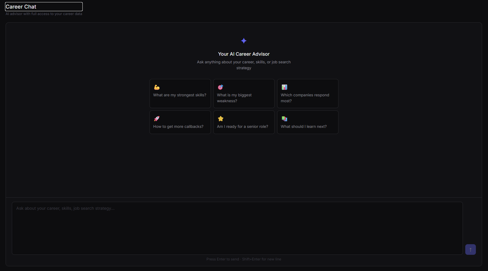
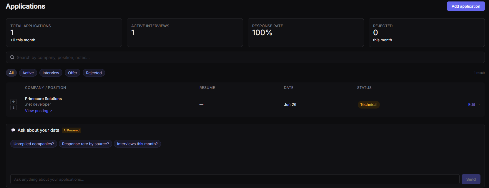
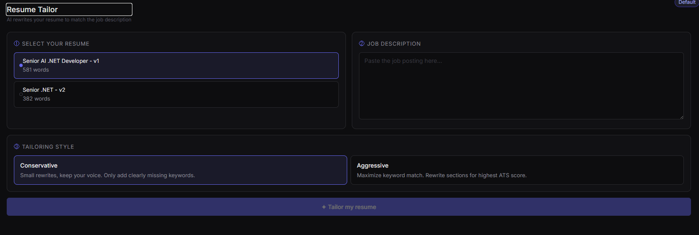

# 🎯 JobHunter.AI

**A hybrid architecture using deterministic C# algorithms for ATS skill matching, scoring inputs, and structure validation; local LLMs are strictly reserved for requirement extraction, response generation, and conversational tool selection.**

[](https://github.com/hadihamedian/JobHunter.AI/actions/workflows/ci.yml)
[](https://dotnet.microsoft.com/)
[](https://dotnet.microsoft.com/apps/aspnet/web-apps/blazor)
[](https://learn.microsoft.com/en-us/dotnet/ai/)
[](https://www.postgresql.org/)
[](https://ollama.com/)
[](https://learn.microsoft.com/en-us/agent-framework/)
[](https://www.docker.com/)
[](./LICENSE)
[](https://deepwiki.com/hadihamedian/JobHunter.AI)

---

## 🧭 Overview

JobHunter.AI is an end-to-end career management platform built to solve a very practical problem: **generic AI resume tools hallucinate, and generic ATS tools are dumb**. This project takes a hybrid approach — deterministic, rule-based logic where accuracy matters (skill matching, scoring, structural validation) combined with a **local LLM (via Ollama)** orchestrated through **Microsoft.Extensions.AI and tools ** for the parts that genuinely benefit from generative reasoning.

The built-in Web App and Ollama can run locally without a paid model API. Local bearer credentials are required for REST and enabled MCP access. External MCP clients may transmit returned records to their model providers. It's both a daily-use tool for managing a job search and a demonstration of applied .NET + Agentic AI architecture: Minimal APIs, Blazor WebAssembly, PostgreSQL, and strict tool invocation pipelines.

---

📸 Screenshots
| Smart Analyze | Career Chat |
| :---: | :---: |
|  |  |

| Applications Dashboard | Resume Tailor |
| :---: | :---: |
|  |  |

---

## ✨ Key Features

| Module | What it does |
|---|---|
| 🧠 **Smart Analyze** | Deterministic resume-to-job-description matching — verifiable skill-gap detection with deterministic skill checks and model-assisted requirement extraction |
| 💬 **Career Chat** | Conversational advisor with on-demand access to your career records via tools |
| 📊 **Applications Dashboard** | Track every application with AI-powered semantic search and direct database query tools |
| 📄 **Resume Manager** | Store, organize, and version multiple resumes with AI-assisted recommendation |
| 🎯 **Resume Tailor** | Self-correcting generative rewriter that checks structural parity with the original resume |
| 🗣️ **Interview Prep** | Realistic, role-specific technical and behavioral questions generated directly from job descriptions |
| 🏦 **Interview Bank** | Filterable, searchable repository of past questions with natural language navigation |
| **MCP Server (local preview)** | Connect compatible AI clients to saved applications, ATS analysis and optional authorized status updates |

---

## MCP Server — local preview

The existing API exposes an opt-in, stateless Streamable HTTP endpoint at `http://localhost:5065/mcp`. Four read tools are available with a read credential; a separate write credential and explicit opt-in are required for status changes. It shares PostgreSQL and the ATS analyzer with the Web App. No internet job search or automatic application submission is provided.

**Verified client smoke tests:** MCP Inspector and VS Code/GitHub Copilot (read access). See the [MCP setup and tool guide](docs/mcp/README.md), [security model](docs/mcp/security.md) and [release notes](docs/mcp/release-notes.md). Run MCP natively on the host; do not expose the endpoint publicly.

---

## 🏗️ Architecture

JobHunter.AI decouples deterministic verification from generative reasoning using **Microsoft.Extensions.AI**:

```
┌──────────────────────────────────────────────────────────────┐
│                        Nginx (reverse proxy)                  │
│                     serves Blazor WASM + /api/* → api         │
└───────────────────────────────┬────────────────────────────────┘
                                │
                ┌───────────────┴──────────────────┐
                │                                  │
┌───────────────▼───────────┐       ┌──────────────▼───────────────┐
│   JobHunter.AI.Web        │ HTTP  │      JobHunter.AI.Api        │
│   (Blazor WebAssembly)    │◄─────►│   (ASP.NET Core Minimal API) │
│                           │       │                              │
│  Pages:                   │       │  Conversational Agents (MAF):│
│   • CareerChat            │       │   • CareerAdvisorAgent       │
│   • Applications (Chat)   │       │   • DataChatAgent            │
│   • Resumes               │       │  Deterministic Services:     │
│   • ResumeTailor          │       │   • AiAnalyzerService        │
│   • InterviewBank         │       │   • ResumeTailorService      │
│                           │       │   • InterviewBankChatService │
└───────────────────────────┘       └──────────────┬───────────────┘
                                                   │
                                       ┌───────────▼────────────┐
                                       │   Ollama (OllamaSharp) │
                                       │   llama3.2:latest      │
                                       └────────────────────────┘
```

**Design Principle:** High-risk logic (keyword checking, structural parity, database filtering, ID resolution) stays in pure C# tools. The LLM acts purely as an agent that selects and executes tools or generates structured content returning structured JSON (JSON mode).

---

## 🛠️ Tech Stack

- **Backend:** ASP.NET Core Minimal API (.NET 10)
- **Agentic Abstraction:** `Microsoft.Extensions.AI` with automated tool invocation (`AIFunctionFactory`)
- **AI/LLM Integration:** Microsoft Agent Framework (`Microsoft.Agents.AI`), `Microsoft.Extensions.AI` (`IChatClient`), and [OllamaSharp](https://github.com/awaescher/OllamaSharp) connecting to local Ollama
- **Frontend:** Blazor WebAssembly
- **Database:** PostgreSQL (via Npgsql)
- **Local AI Engine:** [Ollama](https://ollama.com/) running `llama3.2:latest`
- **Reverse Proxy:** Nginx (serves the WASM app, proxies `/api/*` to backend)
- **Containerization:** Docker & Docker Compose

---

## 🚀 Getting Started

### Option A — Docker (Web App only)

#### Prerequisites

- [Docker](https://docs.docker.com/get-docker/) & Docker Compose
- [Ollama](https://ollama.com/download) installed **on the host machine**, with the model pulled:
  ```bash
  ollama pull llama3.2:latest
  ```

#### Run

```bash
# Clone the repository
git clone https://github.com/hadihamedian/JobHunter.AI.git
cd JobHunter.AI

# In Windows CMD, generate a new secret (Python 3 required)
python -c "import secrets; print(secrets.token_hex(32))"
set "JOBHUNTER_REST_TOKEN=REPLACE_WITH_GENERATED_TOKEN"
docker compose up --build -d
```

Open **http://localhost:5150** and enter the REST token. Keep the services on loopback; Docker MCP is not supported in this preview.

---

### Option B — Manual (without Docker)

#### Prerequisites

- [.NET 10 SDK](https://dotnet.microsoft.com/download)
- [PostgreSQL](https://www.postgresql.org/download/)
- [Ollama](https://ollama.com/download) with `llama3.2:latest`

#### Configuration (local defaults in `JobHunter.AI.Api/appsettings.json`)

```json
{
  "Ollama": {
    "Endpoint": "http://localhost:11434",
    "Model": "llama3.2:latest"
  },
  "ConnectionStrings": {
    "DefaultConnection": "Host=localhost;Database=jobassistant;Username=postgres;Password=postgres"
  }
}
```

#### Run

From the repository root, create the `jobassistant` PostgreSQL database (or configure your existing database). Set private connection details through User Secrets, not committed files. Generate a fresh REST token and configure it:

```cmd
python -c "import secrets; print(secrets.token_hex(32))"
dotnet user-secrets set "RestAuth:Token" "REPLACE_WITH_GENERATED_TOKEN" --project JobHunter.AI.Api
dotnet run --project JobHunter.AI.Api --launch-profile http
```

In another terminal, from the repository root:

```cmd
dotnet run --project JobHunter.AI.Web --launch-profile http
```

Open http://localhost:5150 and enter the REST token. For optional MCP configuration, follow the [MCP guide](docs/mcp/README.md).

## Local demo workspace (optional)

For screenshots and recordings, use a separate local database. In the API's
`appsettings.Development.json`, merge these settings into the existing JSON:

```json
{
  "RestAuth": { "Enabled": false },
  "Database": { "AutoCreate": true },
  "Demo": { "SeedData": true },
  "ConnectionStrings": {
    "DefaultConnection": "Host=localhost;Database=jobhunter_demo;Username=postgres;Password=postgres"
  }
}
```

Use your actual local PostgreSQL credentials privately (prefer User Secrets for
passwords). User Secrets and environment variables take precedence over JSON.
Start PostgreSQL, then the native API and Web App with their `http` launch profiles.
The PostgreSQL role needs `CREATEDB` or equivalent privileges only if the database
is missing. A connection to the maintenance database `postgres` is required for
creation. Existing databases are never dropped or recreated.

Demo seeding requires a local database name ending in `_demo` and empty application,
resume, interview and status-audit tables. It inserts 30 fictional job records,
three sample resumes and 20 interview questions in one transaction. Scores are
illustrative, not computed. A seed-history marker prevents automatic reseeding after
successful insertion, even if records are later deleted. No real data is copied.

REST bypass is disabled by default and only allowed in native Development with
loopback requests and Host headers, without forwarded headers. The Web App probes
`/api/auth/session` and skips login only when the API permits an anonymous session.
MCP authentication and write protection remain independent. Do not proxy or expose
this mode. Restart the API and reload the browser after configuration changes.
Do not commit your demo credentials or use this mode for public deployment.
To return to normal use, restore the original connection string and set
`RestAuth:Enabled=true`, `Database:AutoCreate=false`, `Demo:SeedData=false`, then restart.

## 🧪 Testing

Run `dotnet build JobHunter.AI.slnx -c Release` and `dotnet test JobHunter.AI.slnx -c Release --no-build`. For the full PostgreSQL integration suite, configure the [disposable integration database](docs/mcp/README.md#automated-tests). Without it, integration tests are skipped.

- **Deterministic Tools & Regex**: Table-driven tests in `AtsEvaluationToolsTests` verifying negative lookaround token matching and domain aliases without false positives.
- **Structure Validation**: `ResumeStructureValidatorTests` ensuring markdown sections, bullet counts, and tech stacks are preserved during tailoring.
- **Conversational Agents**: `AgentTests` verifying role mapping, tool execution schemas, and JSON/plain-text fallback using a mocked `IChatClient`.
---

## 📂 Project Structure

```
JobHunter.AI/
├── JobHunter.AI.Api/            # Backend - Minimal API (.NET 10)
│   ├── Mcp/                     # MCP tools, authentication and resource limits
│   ├── Security/                # REST bearer authentication
│   ├── Models/                  # DTOs and contracts
│   ├── Tools/                  # Tools & Native Tools (Ats, Data, Interview, Career)
│   ├── Services/                # Business orchestration using IChatClient
│   ├── Dockerfile
│   └── Program.cs
│
├── JobHunter.AI.Web/            # Frontend - Blazor WASM
│   ├── Pages/                   # Applications, CareerChat, Resumes, ResumeTailor, InterviewBank
│   ├── Layout/
│   ├── Services/                # HTTP API clients
│   └── wwwroot/
│
├── docker-compose.yml           # API + Web + PostgreSQL orchestration
└── JobHunter.AI.slnx
```

---

## 📜 License

Licensed under the [MIT License](./LICENSE).

---

## 👤 Author

**Hadi Hamedian** — Senior .NET Developer & Technical Lead  
Building AI-integrated .NET systems, remote-first.

[GitHub](https://github.com/hadihamedian)